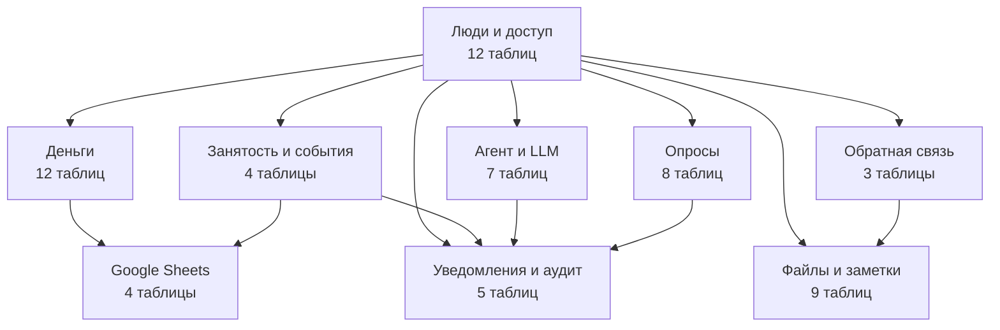
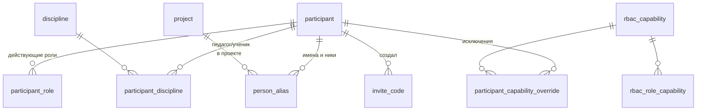
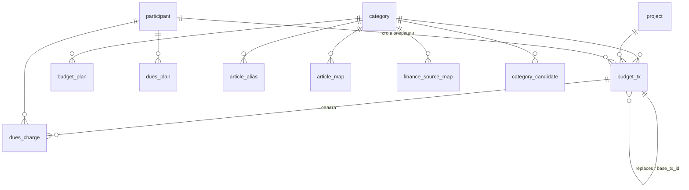
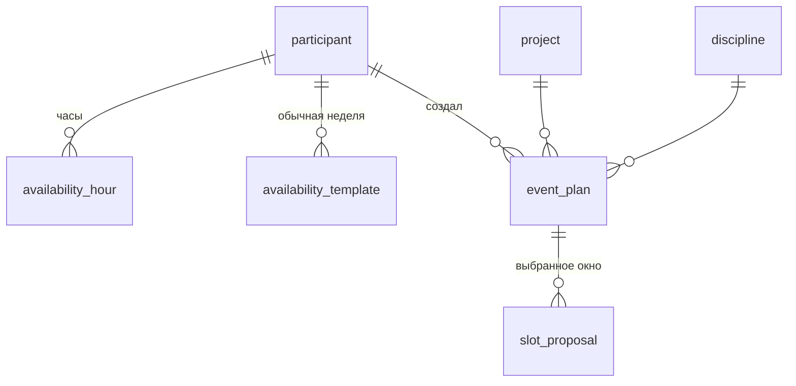
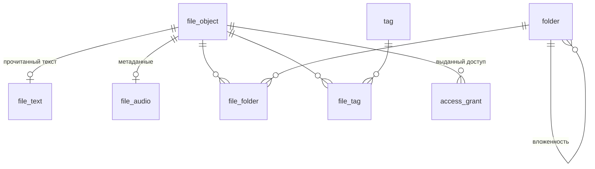
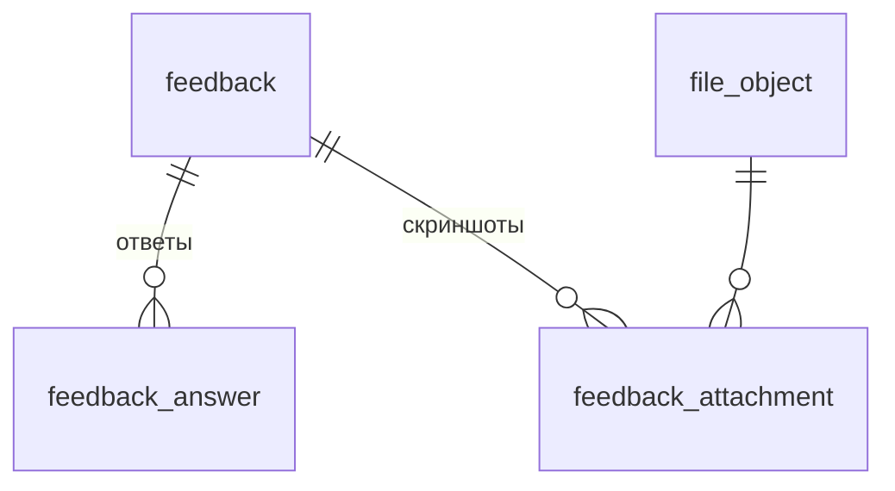
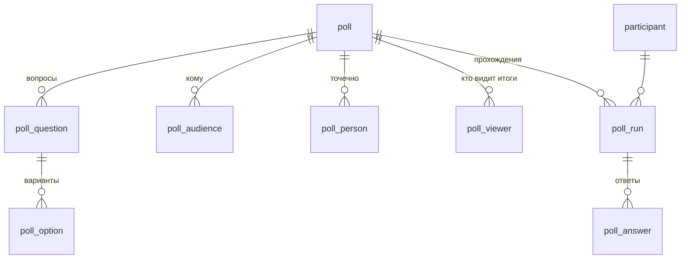
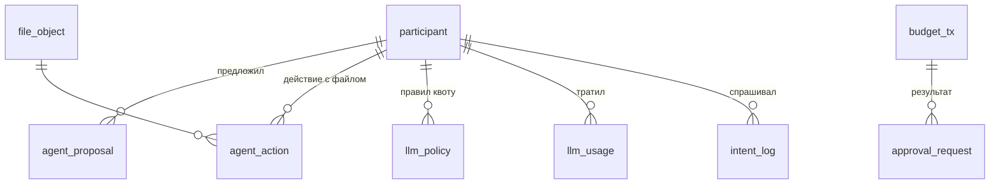
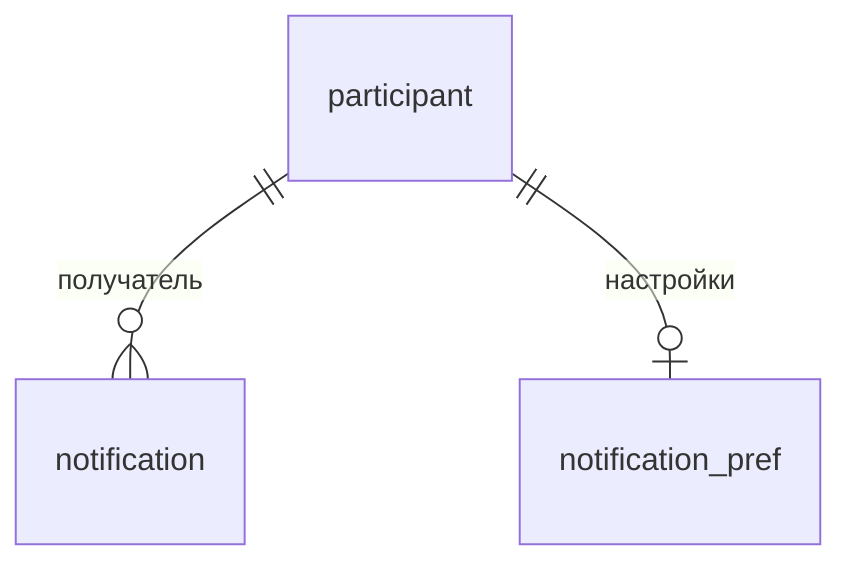

# 169. Схема БД: фактическое состояние

Срез: **2026-11-17**, PostgreSQL 16, ревизия Alembic `066_polls_org_manage`.
Это описание того, что реально лежит в базе, а не того, что задумывалось в ранних версиях.

Чем проверено:

| Что | Чем | Результат |
|---|---|---|
| Состав | `information_schema.tables`, `pg_class` по dev (`127.0.0.1:5433/svoi`) | 64 таблицы предметной области + `alembic_version`, 15 представлений, 552 колонки, 87 внешних ключей |
| Совпадение dev и прода | `pg_dump --schema-only` с dev и с `svoi-prod`, дифф по `CREATE TABLE` / `ALTER TABLE ONLY` / `ADD CONSTRAINT` / `CREATE [UNIQUE] INDEX` / `CREATE VIEW` | 0 расхождений |
| Машинный снимок | `contracts/db-schema.json` (`scripts/db_schema_snapshot.py --write`) | 65 таблиц, 15 представлений |

Сопутствующие файлы:

- `contracts/db-schema.json` — полный снимок: каждая таблица, каждая колонка с типом, `not null`, значением по умолчанию, первичные, уникальные и CHECK-ограничения, внешние ключи, тексты представлений. **Единственное место, где перечислены все 552 колонки**; ниже — смысл и связи.
- `docs/architecture/169-db-schema.svg` — карта всех таблиц с внешними ключами, по доменам. Широкий постер на 7 400 px: открывать и зумить, а не читать в окне. Перерисовывается тем же скриптом (`--dot`).

---

## 1. Зачем этот документ и как им пользоваться

Документы про данные расходились с базой молча: `01-data-model.md` описывает исходную версию
(в ней 8 таблиц, которых в базе нет никогда не было — `session`, `message_event`, `dead_letter`,
`budget_sync_state`, `budget_recon`, `due_member`, `availability`, `tool_call_log`), а 23
существующие таблицы не упомянуты в `docs/architecture` вообще. Ниже — точка отсчёта.

Правило сверки:

1. Документ называет таблицу или колонку, которых нет в `contracts/db-schema.json` → **документ устарел** (либо схема изменилась и снимок не обновили — тогда устарел снимок, см. п. 2).
2. Документ перечисляет значения статуса, которых нет в CHECK-ограничении той же таблицы → устарел.
3. Смысл таблицы не описан в этом файле, а таблица есть → допишите раздел здесь, а не в стороннем документе.

Проверка снимка против живой базы:

```bash
env -u PYTHONPATH .venv/bin/python scripts/db_schema_snapshot.py          # 0 — совпало, 1 — дифф
env -u PYTHONPATH .venv/bin/python scripts/db_schema_snapshot.py --write  # осознанно обновить снимок
env -u PYTHONPATH .venv/bin/python scripts/db_schema_snapshot.py --dot docs/architecture/169-db-schema.dot
```

Снимок пишется по dev-базе из `scripts/_cli.dsn` (окружение → `.env` → локальная база).
Индексы, последовательности, права и данные в снимок не входят: смена индекса документ не
устаревает.

---

## 2. Принципы, на которых держится схема

1. **Два вида истины.** Деньги и занятость — истина в Google-файлах, база хранит индекс,
   историю и метаданные синхронизации (`sheet_binding`, `row_map`, `import_*`). Идентичность,
   права, аудит, уведомления, файлы, опросы — истина только в базе, в Google их нет.
2. **Не удаляем строки.** Есть `status` (`archived`, `rejected`, `reversed`, `cancelled`) или
   `deleted_at`. Архивный человек остаётся в отчётах, его занятость удаляется
   (`docs/architecture/11` §4.2).
3. **Append-only там, где важна история:** `audit_event` (цепочка `prev_hash`/`hash`),
   `budget_tx` (правка = новая строка с `rev` и `replaces`), `notification`, `intent_log`,
   `llm_usage`.
4. **Время:** всё `timestamptz`; бизнес-даты — `date` в таймзоне Самары (UTC+4); рабочий день
   08:00–23:00 (`docs/architecture/11`).
5. **Период** — текст `YYYY-MM` (`budget_period.period`, `budget_tx.period`,
   `dues_charge.period`). Блок учёта — `block` ∈ `dues | expense | show_income | show_cost | sublease`.
6. **Изоляция данных** — через `participant_id` и `scope` (`personal | shared | feedback`
   у файлов, `personal | shared` у папок и заметок). Права — не в `participant.role`,
   а в `participant_role` (строка = действующая роль) → `rbac_role_capability` →
   `v_participant_capabilities`; `participant.role` — только «основная роль» для отображения.
7. **Деньги — кассовым методом**, обязательства отдельно: `status='expected'` в баланс не
   входит, `confirmed` входит (`docs/architecture/11` §1).

---

## 3. Карта доменов



Одна и та же схема целиком — `169-db-schema.svg`. Ниже — по доменам, с ключевыми колонками.

---

## 4. Домены

### 4.1 Люди и доступ (12 таблиц)



**`participant`** — человек и его сессия с ботом. Ключевое: `id`, `tg_chat_id` (уникальный,
личный чат = сессия), `person_key` (нормализованный ключ для сопоставления имён, уникальный,
формат `^[a-zа-я0-9]+(-…)*$`), `display_name`, `role` (`admin|org|troupe|master`),
`status` (`pending|active|blocked|archived`), `is_teacher`, `is_director`, `specialty`,
`ai_manifest` (манифест поведения бота для роли), `write_gender` (`m|f`, как обращаться),
`phone` (`+` и 10–15 цифр), `birth_date`, `travel_minutes` (0–240, дорога до театра),
`dues_tariff` + `dues_tariff_from` (индивидуальный тариф взносов), `plays`, `roles_note`,
`interests`, `drive_folder`, `invited_by`, `invite_code_id`.

**`participant_role`** — единственный источник прав. PK `(participant_id, role)`;
`revoked_at` — роль снята, строка осталась (история). Строку заводит `ensure_role_row`.

**`rbac_capability`** (`code`, `title`, `grp`, `description`) и **`rbac_role_capability`**
(`role`, `capability`) — матрица «роль → возможность», 26 возможностей / 55 пар. Коды —
`docs/development/26`-стиля (`poll.manage`, `file.studio.access`).

**`participant_capability_override`** — персональное исключение из матрицы: PK
`(participant_id, capability)`, `allowed` (да/нет), `reason` (обязателен), `granted_by`.

**`discipline`** (`code`, `name`, `sort_order`) и **`participant_discipline`** — что человек
преподаёт/изучает: `relation` ∈ `teacher | student`. Дисциплина педагога — единственный
источник (`docs/architecture/140`).

**`person_alias`** — как человека называют в файлах и в чате: `alias` (уникален в пределах
человека), `alias_kind` ∈ `name | short | tg_username | payee | external | role`,
`source` ∈ `manual | import | bot`, `project_id` (в проекте «Витя М» может быть другим).
Фамилия в финансах и ник в расписании — два разных алиаса одного `participant`.

**`invite_code`** — код приглашения: `code` (уникален), `role`, `discipline_code`,
`max_uses`/`uses`, `expires_at`. **`invite_attempt`** — журнал попыток ввода (`chat_id`, `ok`),
защита от перебора.

**`project`** — проект/спектакль: `name` (уникально), `kind`, `status`, `starts_on`, `ends_on`.

**`venue`** — пространства (сцена, гримёрка, зал): `code` (уникален), `name`, `kind`,
`calendar_id` (календарь Google, где живут события), `is_active`, `sort_order`.

### 4.2 Деньги (12 таблиц)



**`budget_tx`** — операция, сердце денег (36 колонок). Обязательное: `period` (`YYYY-MM`),
`block`, `tx_date`, `tx_type` (`income|expense|transfer`), `amount > 0`, `purpose`,
`category_id`. Признаки: `status` (`draft | expected | pending_approval | confirmed | rejected | reversed`),
`origin` (`bot|manual|import`), `method` (`cash|card|transfer|unknown`), `is_debt`,
`is_advance` (+ `service_period`), `is_plan`, `rate_pct` (доля от сборов), `base_tx_id`
(от какой операции считается доля), `rev` + `replaces` (правка = новая версия),
`participant_id` (человек в операции), `counterparty`, `article_raw`, `raw_text`,
`source_chat_id`/`source_message_id` (уникальная пара — защита от двойной записи),
`entered_by`/`confirmed_by`/`confirmed_at`, `sheet_written_at`/`sheet_error` (запись в файл),
`idempotency_key`.

**`budget_period`** — месяц учёта: `period` (уникален), `status` (`open|closed`),
`quality` (`draft|clean`, качество данных), `opened_at`, `closed_at`.
**`budget_month_total`** — материализованные итоги периода по блокам (`dues_total`,
`expense_total`, `show_income_total`, `invest_total`, `sublease_total`, `profit_total`),
PK `period`. В коде не читается: итоги считает `v_period_totals`.
**`budget_plan`** — план: `period` + `block` + `category_id` (уникальная тройка),
`amount_planned`, `status` (`planned|cancelled`). В коде не читается.

**`category`** — справочник статей: `name` (уникально), `direction`
(`expense|income|both`), `parent_id` (дерево). Инвариант I3: `tx_type` обязан совпадать с
`direction`.
**`category_candidate`** — статья, предложенная ботом и ждущая утверждения: `name`,
`proposed_text`, `seen_count`, `approved`, `approved_by`. Новые категории — только ручным
подтверждением (`docs/development/21`).
**`article_map`** — разобранный «сырой» текст статьи → `category_id`/`project_id`/
`counterparty` + `kwargs`. **`article_alias`** — синонимы и опечатки («комуналка» →
«Коммунальные платежи»), `raw_text` уникален. В коде не читаются: разбор статей идёт через
`router_llm` + `category_candidate`.

**`dues_plan`** — сколько человек должен за период: PK `(participant_id, period)`, `tariff`,
`amount`, `reason`. **`dues_charge`** — начислено/оплачено: PK `(participant_id, period)`,
`amount_due`, `amount_paid`, `paid_on`, `payment_tx_id`, `status`
(`due|partial|paid|waived|skipped`).

**`finance_granularity`** — с какой детализацией раздел пишется в файл: PK `section`,
`mode` ∈ `per_operation | per_source | per_month`. **`finance_source_map`** — строка листа
(`section`, `label`) → `category_id`/`project_id`, чтобы человек мог менять оформление листа.

### 4.3 Занятость и события (4 таблицы)



**`availability_hour`** — занятость по часам, единица хранения — час: уникальная тройка
`(participant_id, day, hour)`, `hour` 0–23, `is_free`, `kind`
(`busy|free|uncertain|preferred|declared|imported`), `source` (`bot|sheet_import|admin`),
`at_theatre`, `raw_text`. Свод не хранится — считается (`v_availability_summary`).
**`availability_template`** — обычная неделя: PK `(participant_id, weekday)` (0–6),
`status` (`free|busy|uncertain`), `from_min`/`to_min` (0–1440, `from < to`), `note`.

**`event_plan`** — планируемое или состоявшееся событие: `title`, `kind`
(`rehearsal|show|training|rental|meeting|other`), `starts_at < ends_at`, `location`,
`participant_ids bigint[]` (состав — массив, без отдельной таблицы связей),
`status` (`proposed|confirmed|cancelled|done`), `gcal_event_id` (событие в календаре),
`discipline_id`, `project_id`.

**`slot_proposal`** — результат подбора окон: `request` (критерии), `candidates` (варианты),
`chosen_index`, `event_plan_id` (если выбрали). Хранится, чтобы «выбрать второе» работало по
кнопке, а не повторным расчётом.

### 4.4 Google Sheets (4 таблицы)

**`sheet_binding`** — описание листа: `key` (уникален), `spreadsheet_id`, `sheet_title`,
`layout`, `header_row`, `first_data_row`, `first_col`/`last_col`, `header_checksum`
(защита от сдвига колонок человеком), `meta`, `last_read_at`, `last_edit_time`.
**`row_map`** — строка листа ↔ сущность базы: `binding_key`, `entity_type`, `entity_id`,
`sheet_row`, `col_from`/`col_to`, `cell_key`, `content_hash` (что записали), `last_seen_at`,
`is_deleted` (строку убрали из листа).

**`import_batch`** — прогон импорта: `kind` (`budget|schedule|people|projects`), `source`,
`source_hash`, `status` (`running|needs_review|applied|failed`), `stats`.
**`import_row`** — строка источника: `batch_id`, `sheet_title`, `sheet_row`/`sheet_col`,
`raw` (jsonb), `resolved_type`/`resolved_id`, `confidence`, `issue`, `applied`.

Все четыре таблицы в коде приложения **не читаются и не пишутся** — это остаток от
двусторонней синхронизации v2 (`docs/architecture/10`); текущий обмен с файлами идёт через
`api/finance.py` и `schedule_sheet.py` напрямую. Удалять не спешим: описания листов — ценная
документация формата.

### 4.5 Файлы и заметки (9 таблиц)



**`file_object`** — файл: `name`, `mime`, `size_bytes`, `scope`
(`personal|shared|feedback`), `uploaded_via` (`human_drive|human_telegram|bot|webapp|agent`),
`kind` (`text|image|audio|NULL`), хранилище — либо `drive_file_id` (уникальный), либо
`bucket` + `object_key` (Garage/S3), `sha256` (дедупликация), `search_tsv` (полнотекстовый
поиск), `deleted_at` (корзина), `cold_at` (вынесен в холодное хранилище), `meta`, `participant_id`
(владелец личного файла).

**`file_text`** — извлечённый текст: PK `file_id`, `body`, `lang`, `status`
(`ok|text_unavailable`). **`file_audio`** — длительность, битрейт, формат, теги.
**`folder`** — папка: `scope` (`personal|shared`), `participant_id` (обязателен для личной и
`NULL` для общей — CHECK), `parent_id`, `project_id`, `path`, `depth` (1–5), `deleted_at`.
**`file_folder`** — файл в папке, `position` для порядка.
**`tag`** (`slug`, `title` уникальны, `kind`, `status`) + **`file_tag`** — метки файлов.
**`access_grant`** — доступ человека к чужому личному файлу: `file_id`, `admin_id` (кто дал),
`reason` (обязателен, непустой), `expires_at`, `notified_at`. Проверяется в БД на каждом
запросе, кэша прав нет.

**`note`** — заметка: `title`, `body`, `tags text[]`, `scope` (`personal|shared`),
`project_id`, `drive_file_id`, `deleted_at`.

### 4.6 Обратная связь (3 таблицы)



**`feedback`** — обращение из Mini App или чата: `kind` (`bug|wish|wish-fl|question|praise`),
`text`, `context` (jsonb: экран, сборка), `status` (`new|seen|planned|done|rejected`),
`resolution`, `resolved_at`. **`feedback_answer`** — публичный ответ: `source`
(`agent|human|server`), `status`, `text`, `question_id`, `commit_sha` (в какой сборке
исправлено). **`feedback_attachment`** — вложение: PK `(feedback_id, file_id)`, `file_id`
уникален (файл принадлежит одному обращению), `position`.

### 4.7 Опросы (8 таблиц)



**`poll`** — анкета: `title` (непустой), `intro`, `status` (`draft|running|closed`),
`anonymous`, `closes_at`, `created_by`, `started_at`, `closed_at`.
**`poll_question`** — вопрос: `position` (уникален в опросе, > 0), `text`, `kind`
(`single|multi|yesno|number|text`), `required`, `free_text` (можно свой вариант),
`max_choices`.
**`poll_option`** — вариант: `code` (1–2 символа, уникален в вопросе), `label`, `position`.
**`poll_audience`** — аудитория: `kind` (`all_active|role|project`) и ровно одно из
`role`/`project_id` (CHECK). **`poll_person`** — точечное включение/исключение: PK
`(poll_id, participant_id)`, `mode` (`include|exclude`).
**`poll_run`** — прохождение: уникально `(poll_id, participant_id)`, `status`, `position`
(на каком вопросе остановился), `message_id`, `started_at`, `finished_at`.
**`poll_answer`** — ответ: PK `(run_id, question_id)`, `option_codes text[]`,
`text_value`, `number_value`, `skipped`.
**`poll_viewer`** — адресный доступ к итогам: `poll_id` + `participant_id` **или** `role`.
Отдельно от `poll.manage`: организатор видит свои опросы, чужие открываются адресно.

### 4.8 Агент и LLM (7 таблиц)



**`agent_proposal`** — предложение инструмента с кнопкой подтверждения: `token` (уникален),
`chat_id`, `participant_id`, `tool`, `args`, `human_text` (что видит человек), `status`
(`pending|confirmed|cancelled|expired|failed`), `result`, `error`, `expires_at`,
`confirmed_by`. Исполняет детерминированный код, не модель.
**`agent_action`** — действие с файлами (`move|rename|tag|summarize|answer`), `payload`,
`status` (`proposed|applied|rejected|expired`).
**`intent_log`** — журнал разбора сообщения: `text`, `intent_rules`/`intent_llm`,
`category_rules`/`category_llm`/`category_final`, `source`
(`rules|llm|buttons|human_new|failed|cache`), `confidence`, `steps`, `step_count`,
`agent_status` (`answer|proposal|refusal`), `answer`, `degraded_reason`, `tokens`,
`latency_ms`, `resolved`. Срок хранения 90 дней (`docs/development/21`).
**`llm_policy`** — квоты: `scope` (`global|role|participant`) + `scope_key`, `daily_requests`,
`monthly_tokens`, `monthly_cost_rub`, `max_tokens_request`, `model_allowlist`, `hard_stop`.
**`llm_usage`** — расход: `model`, `provider`, `tokens_in`/`tokens_out`, `cost_rub`,
`status` (`ok|error|stopped`), `price_status` (`known|no_price`), `request_id`, `intent`.
**`approval_request`** — очередь согласования расхода: `payload`, `amount`, `tx_type`,
`status` (`pending|approved|rejected|expired`), `budget_tx_id`. **Устарела по решению
30.10.2026** (второе подтверждение отменено, `docs/architecture/25` §4): в коде не
используется, таблица оставлена как история решения.
**`job`** — очередь фоновых задач: `kind`, `run_at`, `payload`, `status`
(`pending|running|done|failed`), `attempts`, `locked_until`. В коде не используется:
напоминания и отчёты запускает системный cron.

### 4.9 Уведомления и аудит (5 таблиц)



**`notification`** — исходящее уведомление (outbox): `kind`, `payload`, `dedupe_key`
(уникален вместе с получателем — повтор не отправится), `scheduled_at`, `status`
(`scheduled|sent|failed|cancelled|skipped`), `attempts`, `last_error`, `sent_at`.
**`notification_pref`** — PK `participant_id`: `kinds_muted text[]`, `quiet_from`/`quiet_to`
(тихие часы, по умолчанию 20:00–08:00), `digest_enabled`.
**`audit_event`** — аудит: `ts`, `actor_type` (`human|bot|system`), `actor_id`, `action`,
`entity_type`, `entity_id`, `before`/`after` (jsonb), `correlation_id`, `source` (jsonb),
`prev_hash`/`hash` — цепочка, разрыв виден при подмене строки.
**`app_setting`** — настройки в БД: `key` (PK), `value`. Сейчас: `poll`,
`default_venue_code`, `notify_quiet_from`, `notify_quiet_to`, `notify_kinds_muted`.
**`migration_marker`** — журнал опасных data-миграций (`key`, `applied_at`, `note`),
страховка от повторной инверсии/переноса. Учёт применённого — не здесь, а `alembic_version`.

---

## 5. Представления (15)

| Представление | Что считает | Кто читает |
|---|---|---|
| `v_invariant_checks` | инварианты I1–I9 по деньгам и данным, по строке на код | `scripts/check_invariants.py` |
| `v_file_checks` | инварианты по файлам и папкам (изоляция, сироты) | `scripts/check_invariants.py` |
| `v_balance` | взносы + подтверждённые доходы − расходы, итог студии | `check_invariants`, админка |
| `v_period_totals` | доходы/расходы по блокам за период | `check_invariants` |
| `v_dues_balance` | у кого взносы не закрыты (`amount_due <> amount_paid`) | `scripts/plan_reminders.py` |
| `v_participant_capabilities` | действующие возможности человека: роль + персональные исключения | `core.resolve_caps` |
| `v_participant_roles` | роли человека массивом, без отозванных | `core` |
| `v_participant_disciplines` | дисциплины человека и его отношение (`teacher`/`student`) | `core`, `api/events` |
| `v_master_without_discipline` | педагоги без дисциплины (нарушение `docs/architecture/140`) | `check_invariants` |
| `v_active_participants` | люди, кроме `archived` | в коде не читается |
| `v_availability_summary` | свободных/занятых/известных по часу, без архивных | в коде не читается |
| `v_llm_balance` | расход LLM против квоты за день/месяц | `api/route.py` |
| `v_intent_gaps` | сообщения, которые разбор не понял (кандидаты в новые интенты) | `api/admin.py` |
| `v_intent_degraded` | ответы в режиме деградации | `tests/integration/test_agent_observability.py` |
| `v_top_unmatched` | топ-100 неразобранных текстов по частоте | в коде не читается (`scripts/intent_report.py` берёт из `intent_log`) |

---

## 6. Что уже устарело (сверено со снимком)

| Где | Что не так | Что делать |
|---|---|---|
| `docs/architecture/01-data-model.md` | 8 `create table`, которых в базе нет: `session`, `message_event`, `dead_letter`, `budget_sync_state`, `budget_recon`, `due_member`, `availability` (заменена на `availability_hour` → `availability_template`), `tool_call_log`. Документ сам помечен как история — но им пользуются как схемой | читать 169, не 01 |
| `docs/architecture/10-data-model-v2.md` | описывает `sheet_binding`/`row_map`/`import_*` как механизм обмена, которого в коде нет; 51 таблицу не упоминает | формат листов оставить, «обмен» читать тут |
| `docs/architecture/25-architecture-evolution.md` §4 | отмена второго подтверждения расхода | `approval_request` — мёртвая таблица |
| `docs/development/21-intent-cascade.md` | описывает `intent_log` без `agent_status`/`steps`/`degraded_reason` | дополнено здесь, §4.8 |
| `docs/architecture/*` в целом | 23 таблицы не упомянуты ни разу: `access_grant`, `agent_action`, `agent_proposal`, `availability_template`, `budget_month_total`, `feedback_answer`, `feedback_attachment`, `file_audio`, `file_folder`, `file_tag`, `file_text`, `finance_granularity`, `finance_source_map`, `invite_attempt`, `migration_marker`, `poll_answer`, `poll_audience`, `poll_option`, `poll_person`, `poll_question`, `poll_run`, `poll_viewer`, `tag` | описаны здесь |

Мёртвое в коде (существует, но приложение не читает и не пишет): `job`, `import_batch`,
`import_row`, `sheet_binding`, `row_map`, `article_map`, `article_alias`, `dues_plan`,
`budget_plan`, `budget_month_total`, `approval_request`, `migration_marker` (только
`scripts/reset_for_release.py`), `llm_policy` (только тесты). Плюс три представления из §5.
Это не повод удалять: часть — история решений, часть — описание формата файлов. Но документ,
который ссылается на них как на рабочий механизм, устарел.

---

## 7. Риски и ограничения

1. **Снимок по dev-базе.** Прод на той же ревизии и структурно совпадает (проверено
   `pg_dump`), но проверка снимка из CI смотрит в dev. Сверка с продом — отдельная команда.
2. **Данные в снимок не входят.** Расхождение в значениях (например, статья заведена в
   `category_candidate` и не утверждена) снимок не поймает — для этого инварианты.
3. **Часть таблиц описана по коду и миграциям, не по фактическому использованию:** `job`,
   `sheet_binding`, `row_map`, `import_*` никто не наполняет, поэтому их поведение «как
   задумано», а не «как работает».
4. `db/init/*.sql` неизменяемы (правило `docs/reports/132`): новая таблица — новый файл и
   новая ревизия. Этот документ и снимок обновляются тем же коммитом, что и миграция.
