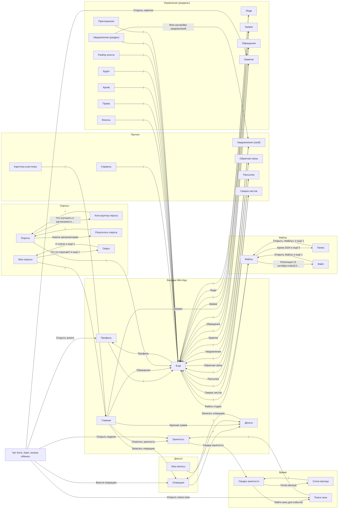

# 167. Единый граф переходов: чат бота → экраны Mini App

**Дата:** 17.11.2026. **Собирается:** `scripts/build_screen_map.py` — не правится руками.
**Заменяет:** `docs/archive/prototypes/44-menu-map.html` (описывал меню и шесть экранов;
в коде четыре вкладки и 36 экранов).
**Связано:** `docs/development/92-navigation-model.md` (модель навигации),
`docs/development/141-miniapp-design-review.md` (инвентарь экранов),
`docs/development/91-design-system.md` (вид), `docs/development/173-prototype-workspace.md`
(как с этим работаем).

Источник истины — код: `tests/webapp/server.py` отдаёт те же страницы, что боевой tool-api,
поэтому рёбра графа — настоящие `<a href>` со стенда, а подписи — текст кнопок. Документ
устаревает только вместе с кодом: пересборка — одна команда.

## 1. Граф

Полоса вкладок («Главная · Время · Деньги · Управление») есть на каждом экране и ведёт в
четыре корня. На графе она не нарисована: 35 × 4 одинаковых линий сделали бы схему нечитаемой.
Стрелка «‹» — возврат на уровень выше.



## 2. Экраны

Права — из реестра `SECTIONS` (`services/tool-api/app/webapp.py`): экран рисуется, только если
возможность есть; данные всё равно проверяются в API.

| Адрес | Экран | Права |
|---|---|---|
| `/webapp` | Профиль | — |
| `/webapp/home` | Главная | — |
| `/webapp/money` | Деньги | — |
| `/webapp/more` | Ещё | — |
| `/webapp/week` | Занятость | — |
| `/webapp/admin/t/agent` | Разбор агента | admin.panel |
| `/webapp/admin/t/archive` | Архив | participants.manage |
| `/webapp/admin/t/audit` | Аудит | audit.view |
| `/webapp/admin/t/dues` | Взносы | budget.write |
| `/webapp/admin/t/feedback` | Обращения | feedback.triage |
| `/webapp/admin/t/invites` | Приглашения | registration.code.issue |
| `/webapp/admin/t/notifications` | Уведомления | admin.panel |
| `/webapp/admin/t/pending` | Заявки | registration.approve |
| `/webapp/admin/t/people` | Люди | participants.view |
| `/webapp/admin/t/rights` | Права | participants.manage |
| `/webapp/broadcast` | Рассылка | notify.send |
| `/webapp/dues` | Мои взносы | — |
| `/webapp/feedback` | Обратная связь | — |
| `/webapp/file` | Файл | — |
| `/webapp/files` | Файлы | files.access |
| `/webapp/folder` | Папка | — |
| `/webapp/notes` | Заметки | notes.write |
| `/webapp/notifications` | Уведомления | — |
| `/webapp/person` | Карточка участника | — |
| `/webapp/polls` | Опросы | poll.manage |
| `/webapp/polls/answer` | Опрос | — |
| `/webapp/polls/edit` | Конструктор опроса | — |
| `/webapp/polls/mine` | Мои опросы | — |
| `/webapp/polls/results` | Результаты опроса | — |
| `/webapp/reconcile` | Сверка листов | budget.import |
| `/webapp/services` | Сервисы | admin.panel |
| `/webapp/slots` | Поиск окон | — |
| `/webapp/tx` | Операция | — |
| `/webapp/ui` | Элементы интерфейса | — |
| `/webapp/week/month` | Сетка месяца | — |
| `/webapp/week/summary` | Сводка занятости | — |

## 3. Старые адреса (редиректы 301)

Адреса не удаляются: ссылки в чате и закладках живут дальше.

| Было | Стало |
|---|---|
| `/webapp/admin` | `/webapp/admin/t/people` |
| `/webapp/assign` | `/webapp/slots` |
| `/webapp/days` | `/webapp/week` |
| `/webapp/my/sheet` | `/webapp/week` |
| `/webapp/people` | `/webapp/admin/t/people` |
| `/webapp/schedule` | `/webapp/week/summary` |
| `/webapp/search` | `/webapp/admin/t/people` |

## 4. Как обновить

```
# стенд
env -u PYTHONPATH .venv/bin/python -m uvicorn tests.webapp.server:app --port 8799
# граф и атлас экранов
env -u PYTHONPATH .venv/bin/python scripts/build_screen_map.py
```

Скрипт падает, если на экране есть ссылка на адрес, которого нет среди экранов и редиректов:
это дефект стенда или приложения, а не повод нарисовать стрелку «куда-нибудь».

## 5. Что не попало на граф

- **Пункты меню чата** (Деньги · Время · Админ · Профиль · Помощь) — это `callback_data`,
  а не адреса: они не ведут в Mini App, а работают в чате. Их состав — `keyboards.menu_groups`.
- **Динамические кнопки** бота: адрес собирается из переменной (`screen`, константы страниц).
  Они видны на графе как сами экраны, к которым ведут.
- **Снимки экранов** — в `docs/reports/171-screens-atlas.html` (собирается тем же прогоном).


