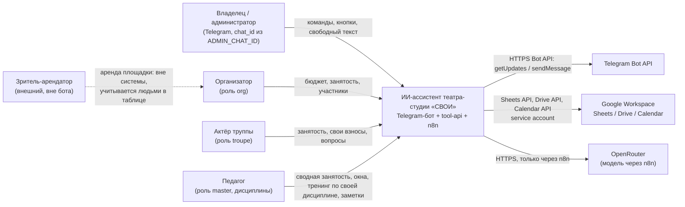
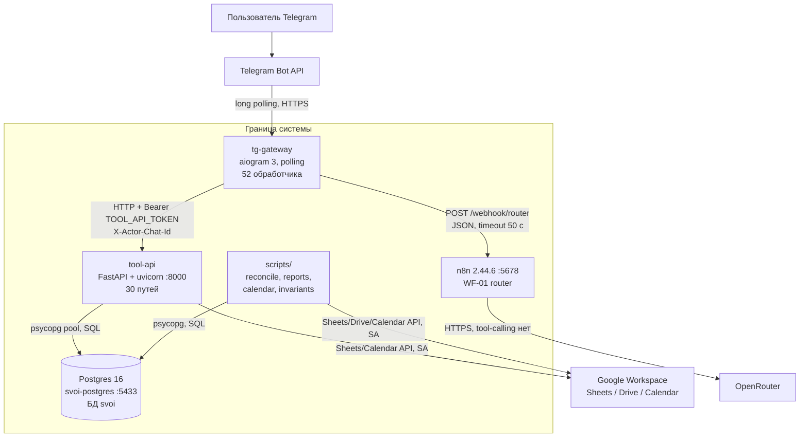
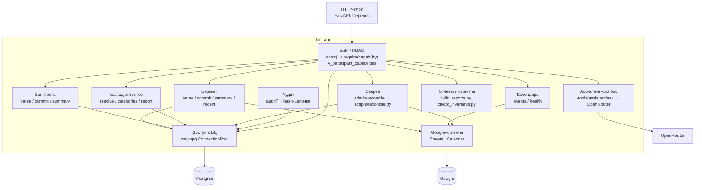
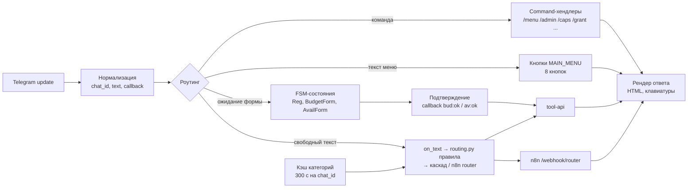
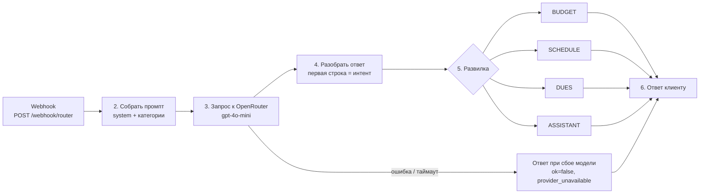
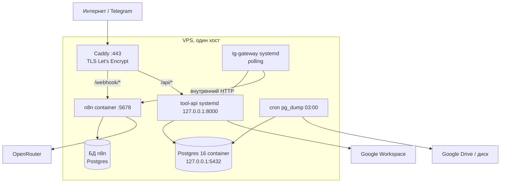

# 30. Архитектура в C4-подобной нотации

> **n8n выведен из контура (V-026, 01.11.2026).** Диаграммы и таблицы ниже описывают контур
> до этого решения: читать их без n8n — роутер свободного текста `POST /tools/route` в tool-api
> (`services/tool-api/app/router_llm.py`), публичного вебхука и контейнера нет.
> История — `docs/archive/29-n8n-scenarios.md`.

Актуально на 26.10.2026. Документ описывает **фактическое** состояние репозитория, а не целевое.
Дополняет `ARCHITECTURE.md` (ADR), `docs/infrastructure/24` (прод), `docs/architecture/25` (эволюция), `docs/archive/29-n8n-scenarios.md` (n8n).

Нотация упрощённая: C1 — контекст, C2 — контейнеры, C3 — компоненты внутри контейнеров,
deployment — развёртывание. Диаграммы — mermaid и ASCII.

**Как проверялось.** Все утверждения ниже сверены командами по репозиторию и живому
локальному контуру:

| Проверка | Команда | Результат |
|---|---|---|
| Маршруты API | `grep -c "^@app\." services/tool-api/app/main.py` | 37 декораторов, 30 уникальных путей |
| Обработчики бота | `grep -c "^@router\." services/tg-gateway/app/main.py` | 52 |
| Таблицы | `alembic upgrade head` на чистой БД + `select count(*) from information_schema.tables where table_schema='public' and table_type='BASE TABLE'` | 56 таблиц и 13 представлений |
| Возможности RBAC | `select count(*) from rbac_capability` | 18 |
| Данные | `select count(*) ...` в БД `svoi` | 91 операция, 7 232 часа, 10 активных, 7 в архиве |
| Тесты | `grep -rn "def test_" tests` | 130 функций `test_` в 25 файлах |
| n8n | `docker exec n8n-dev n8n --version` | 2.44.6 |
| Версия Python-зависимостей | `services/*/requirements.txt` | fastapi>=0.115, aiogram>=3.15, psycopg>=3.2 |

Расхождения с ранее зафиксированными цифрами (112 тестов, 7 217 часов, 27 эндпоинтов)
объяснены в §9.

---

## 1. C1. System Context

Кто пользуется системой и с чем она взаимодействует. Внутреннее устройство скрыто.



### 1.1 Акторы

| Актор | Как попадает в систему | Что делает | Что не делает |
|---|---|---|---|
| Владелец / администратор | `ADMIN_CHAT_ID` при bootstrap; роль `admin` | выдаёт инвайты, утверждает регистрации, grants, сверка, аудит, health | не редактирует данные в обход API |
| Организатор | инвайт-код с ролью `org` + утверждение | бюджет, занятость, участники, отчёты | не управляет ролями admin |
| Актёр труппы | инвайт-код с ролью `troupe` + утверждение | сообщает занятость, смотрит свои взносы, задаёт вопросы | не видит чужие долги и сводный бюджет |
| Педагог | роль `master` выдаёт админ в карточке человека вместе с дисциплиной (`db/init/061_master_role.sql`); кодом не выдаётся | сводная занятость труппы, свои отметки и окна, назначение тренингов по своей дисциплине, личные и общие заметки, состав труппы | не видит деньги театра и рассылку, не управляет людьми и ролями, не открывает админ-панель; своих взносов не видит, пока у человека нет отдельной роли `troupe` |
| Зритель-арендатор | **вне бота**: аренда площадки, коммуникация с организатором | создаёт доход «Субаренда» руками в таблице | не имеет Telegram-доступа, не является участником |

Роль `student` удалена миграцией `db/init/017_drop_student_role.sql`; карта Э1
(`db/init/061_master_role.sql`) добавила четвёртую роль `master`, поэтому набор — `admin`,
`org`, `troupe`, `master` (`docs/architecture/140-master-role.md`).

### 1.2 Внешние системы

| Система | Зачем | Кто обращается | Что система не решает |
|---|---|---|---|
| Telegram Bot API | доставка апдейтов и сообщений | только `tg-gateway` | не хранит состояние бота (FSM в памяти процесса) |
| Google Sheets | источник истины по бюджету и занятости | только `tool-api` (и `scripts/reconcile.py`, `scripts/build_reports.py`) | не проверяет права и не пишет аудит |
| Google Drive | файлы, `Расписание СВОЙ.xlsx`, записная книжка | только `scripts/` (сверка, поиск файлов); `tool-api` Drive API не вызывает | — |
| Google Calendar | боевой календарь (чтение) и черновой (запись скриптом) | только `tool-api` / `scripts/calendar_fill_draft.py` | не является источником истины по занятости |
| OpenRouter | классификация интента и формулировка ответа | только n8n WF-01 | не принимает решений о данных, не имеет доступа к БД и Google |
| n8n | оркестрация LLM-сценария | `tg-gateway` по HTTP | не хранит бизнес-данные |

### 1.3 Границы системы

Внутри: `tg-gateway`, `tool-api`, Postgres, n8n, скрипты `scripts/`, конфигурация `config/`.

Снаружи: Telegram, Google, OpenRouter. Сеть между ними — только исходящие HTTPS-вызовы.

Не входит в систему (подтверждено `ARCHITECTURE.md` §1): групповые чаты, платёжные интеграции,
парсинг банковских выписок, билетные сервисы, субаренда как процесс, согласия на ПД.

---

## 2. C2. Containers



### 2.1 Сводная таблица

| Контейнер | Технологии | Порт | Состояние | Развёртывание |
|---|---|---|---|---|
| `tg-gateway` | Python, aiogram 3.15+, httpx, MemoryStorage | нет входящего | работает локально | сейчас `.venv` + polling; прод — systemd, см. `docs/infrastructure/24` §4.4 |
| `tool-api` | Python, FastAPI 0.115+, pydantic v2, psycopg 3 pool | 8000 | работает локально | сейчас uvicorn; прод — systemd на `127.0.0.1:8000` |
| Postgres 16 | `postgres:16`, том `pgdata` | 5433 → 5432 | работает, `svoi-postgres` | docker; прод — docker, только localhost |
| n8n | `n8nio/n8n`, версия 2.44.6 | 5678 | работает, `n8n-dev` | docker; прод — docker + Postgres, `docs/infrastructure/24` §4.5 |
| Google Workspace | Sheets/Drive/Calendar API, service account | — | доступен | внешний, ничего не разворачиваем |
| `scripts/` | Python + psycopg + google-api-python-client | — | запуск вручную / cron | вне контейнеров, из корня репозитория |

### 2.2 tg-gateway

| Параметр | Факт |
|---|---|
| Зона ответственности | приём апдейтов Telegram, меню и кнопки, FSM-формы, вызов `tool-api`, вызов n8n-роутера, рендер ответа |
| Технологии | aiogram 3 (`Router`, `StatesGroup`, `MemoryStorage`), httpx |
| Что НЕ делает | не ходит в Postgres, не вызывает Google API, не содержит бизнес-правил, не считает суммы |
| Протоколы | исходящий HTTPS к Telegram (long polling); HTTP к `tool-api` с заголовками `Authorization` (Bearer, токен `TOOL_API_TOKEN`) и `X-Actor-Chat-Id`; HTTP к n8n `POST /webhook/router` |
| Состояние | FSM в памяти процесса (`MemoryStorage`) — при рестарте незавершённые формы теряются |
| Развёртывание | сейчас `dp.start_polling` (`services/tg-gateway/app/main.py:1385`); прод — systemd, `Restart=always` |

Важно: переменной `MODE` нет ни в `.env.example`, ни в коде — реализован только polling.
Решение 28.10.2026: релиз выходит на polling, webhook — задача после релиза
(`docs/infrastructure/35` §5b).

### 2.3 tool-api

| Параметр | Факт |
|---|---|
| Зона ответственности | единственная точка чтения/записи данных: RBAC, бюджет, занятость, календарь, интенты, сверка, аудит, отчёты |
| Технологии | FastAPI, pydantic v2, psycopg 3 + `ConnectionPool` (min 1, max 8), google-api-python-client |
| Что НЕ делает | не ведёт диалог, не хранит FSM, не вызывает LLM в основном пути (кроме `/tools/assistant/ask`, см. §3.1), не отправляет сообщения в Telegram |
| Протоколы | HTTP REST/JSON; SQL к Postgres; HTTPS к Google API |
| Аутентификация | `Authorization` (Bearer `TOOL_API_TOKEN`) + `X-Actor-Chat-Id`; актор резолвится в `participant` |
| Развёртывание | сейчас uvicorn на 8000; прод — systemd `127.0.0.1:8000` за Caddy |

Маршруты: 30 уникальных путей, 37 декораторов (в `main.py` продублированы блоки
`/tools/budget/parse`, `/tools/availability/parse|commit|summary`, `/tools/dues/me` —
см. §9). Дубли не меняют контракт: FastAPI регистрирует повторы, побеждает первое совпадение,
но это технический долг.

### 2.4 Postgres 16

| Параметр | Факт |
|---|---|
| Зона ответственности | индекс данных, зеркало бюджета, `availability_hour`, RBAC, инвайты, аудит, журнал интентов, очередейные таблицы |
| Технологии | `postgres:16`, БД `svoi`, пользователь `svoi`, том `pgdata` |
| Что НЕ делает | не является источником истины по деньгам и занятости (источник — Google-файлы, `ARCHITECTURE.md` ADR-3) |
| Протоколы | PostgreSQL wire protocol, порт 5433 на хосте |
| Схема | 56 таблиц и 13 представлений; накат — цепочка ревизий Alembic (`alembic upgrade head`, в compose — one-shot сервис `migrate`), учёт применённого — `alembic_version`. Голову печатает `alembic heads`, число файлов — `ls db/init`; правило «файл + ревизия» — `docs/development/26` §5 |
| Развёртывание | сейчас docker на 5433; прод — docker, порт только `127.0.0.1`, ежедневный `pg_dump` |

### 2.5 n8n

| Параметр | Факт |
|---|---|
| Зона ответственности | WF-01: классификация текста (BUDGET / SCHEDULE / DUES / ASSISTANT), выбор категории из закрытого списка, свободный ответ |
| Технологии | n8n 2.44.6, Code-узлы на JS, HTTP Request к OpenRouter, модель `openai/gpt-4o-mini`, `temperature 0.2`, `max_tokens 700` (выведено из контура, V-026) |
| Что НЕ делает | не ходит в Postgres, не вызывает Google API, не пишет данные, не является источником фактов |
| Протоколы | входящий `POST /webhook/router` (JSON, без аутентификации — причина отказа от n8n), исходящий HTTPS к OpenRouter |
| Развёртывание | сейчас `n8n-dev` на 5678, данные в SQLite; прод — docker, перевод на Postgres (`docs/infrastructure/24` §4.5) |

Состояние WF-01: по `docs/archive/29-n8n-scenarios.md` — единственный работавший воркфлоу. С V-026
(01.11.2026) n8n выведен из контура: маршрут `POST /tools/route` в tool-api
(`services/tool-api/app/router_llm.py`), WF-01 и `n8n/` удалены из репозитория.

### 2.6 Google Workspace

| Параметр | Факт |
|---|---|
| Зона ответственности | хранение боевых таблиц и календаря; люди правят их руками |
| Технологии | service account `svoi-tool-api@<project-id>.iam.gserviceaccount.com`, ключ `secrets/google-sa.json` |
| Что НЕ делает | не проверяет права пользователей бота, не пишет аудит |
| Протоколы | Sheets API v4 и Calendar API v3 — из `tool-api`; Drive API (`drive.readonly`) — из `scripts/reconcile.py`; всё по HTTPS |
| Объекты | таблица «Бюджет», лист занятости, `Расписание СВОЙ.xlsx` (`SCHEDULE_XLSX_ID`, читает `scripts/reconcile.py`), «Записная книжка театра» (`CONTACTS_SPREADSHEET_ID`), `CALENDAR_ID_READ`, `CALENDAR_ID_DRAFT` |
| Развёртывание | внешний сервис; доступ выдаётся расшариванием на email SA |

---

## 3. C3. Components

### 3.1 tool-api



| Компонент | Эндпоинты | Логика | Зависимости |
|---|---|---|---|
| auth / RBAC | все защищённые | `actor()` проверяет Bearer и `X-Actor-Chat-Id`, находит участника; `require(cap)` сверяет capability из `v_participant_capabilities`; иначе 403 и запись в аудит | Postgres |
| Бюджет: разбор | `POST /tools/budget/parse` | детерминированные правила `rules.parse_budget_text` (глаголы, категории, суммы), без LLM | — |
| Бюджет: запись | `POST /tools/budget/commit` | проверка `budget.write`, `idempotency_key` (или сгенерированный), `insert ... on conflict do nothing`, затем best-effort append в лист «Транзакции» | Postgres, Sheets |
| Бюджет: сводка | `GET /tools/budget/summary`, `/recent` | суммы по периодам, `dues_charge`, остаток; `budget.read` | Postgres |
| Занятость | `POST /tools/availability/parse` + `commit`, `GET /tools/availability/summary` | разбор «занят в среду после 18» без LLM; запись часов через upsert; сводка по дням | Postgres |
| Календарь | `GET /tools/calendar/health`, `/tools/calendar/events` | проверка доступа SA к двум календарям; чтение событий на N дней, `draft=true` — черновой | Google Calendar |
| Каскад интентов | `POST /tools/intent/resolve`, `GET /tools/intent/categories`, `/report` | правила → категория модели из закрытого списка → кнопки; пишет `intent_log`, неизвестную категорию — в `category_candidate` | Postgres |
| Сверка | `POST /admin/reconcile` | `subprocess` запускает `scripts/reconcile.py` с `--only` и `--apply`, возвращает первые 40 строк вывода, пишет аудит | Postgres, Google, файловая система |
| Аудит | `GET /tools/audit/recent` | append-only `audit_event`, `prev_hash` + sha256, чтение по `audit.view` | Postgres |
| Отчёты/скрипты | вне HTTP | `scripts/build_reports.py` (месячные листы, матрица занятости, журнал), `check_invariants.py`, `intent_report.py`, календарные скрипты | Postgres, Google |
| Ассистент-фолбэк | `POST /tools/assistant/ask` | прямой вызов OpenRouter из API, квоты по `llm_usage`, запись токенов | OpenRouter, Postgres |

Замечания по фактическому состоянию:

- `calendar/events` только читает. Создание событий, `RRULE`, проверка конфликтов — **не реализовано**.
- `/tools/assistant/ask` — второй путь к модели, помимо n8n; в продуктивном сценарии не используется,
  но он существует и вызывает OpenRouter напрямую.
- `admin/reconcile` запускает скрипт синхронно, таймаут 300 с; это блокирующий вызов внутри HTTP-запроса.
- Проверки целостности hash-цепочки аудита нет: цепочка пишется, но скрипта верификации в репозитории нет.

### 3.2 tg-gateway



| Компонент | Где | Что делает |
|---|---|---|
| Роутинг сообщений | `services/tg-gateway/app/main.py` + `services/tg-gateway/app/routing.py` | порядок: `CommandStart` → команды → `StateFilter` формы → `MENU_ACTIONS` → свободный текст. Свободный текст сначала проходит детерминированные правила `routing.py` (availability, budget, about_me, list_people, howto, money, schedule); если ни одно не сработало — уходит в n8n |
| Меню | `MAIN_MENU` | 8 кнопок: Расход, Доход, Занятость, Мои взносы, Бюджет, Расписание, Админ-панель, Помощь |
| Формы | `Reg`, `BudgetForm`, `AvailForm` | пошаговый ввод с inline-подтверждением; состояние в `MemoryStorage` |
| Рендер ответов | `clean_answer`, `money`, `kb` | снимает JSON-обёртку модели, форматирует суммы, собирает клавиатуры |
| Кэш категорий | `_cats_cache` | TTL 300 с на `chat_id`; источник — `/tools/intent/categories` |
| Кэш пользователя | `_user_cache` | имя и роли на процесс, без TTL; после смены роли требуется рестарт |
| Клиент API | `api()` | таймаут 25 с, Bearer, `X-Actor-Chat-Id`, логирование 4xx/5xx |
| Клиент n8n | `router_ask()` | таймаут 50 с, пустой dict при сбое — gateway уходит в кнопки |

### 3.3 n8n WF-01



| Узел | Тип | Роль |
|---|---|---|
| Webhook | `webhook` | принимает `{text, user:{name, roles}, categories[]}` |
| 2. Собрать промпт | `code` | системный промпт: только классификация и текст, категории — закрытым списком, без доступа к данным |
| 3. Запрос к OpenRouter | `httpRequest` | модель, температура, лимит токенов; ключ — в credentials n8n |
| 4. Разобрать ответ | `code` | выделяет интент и `CATEGORY`, чистит текст |
| 5. Развилка | `switch` | четыре ветки; ветки — `noOp`, они документируют маршрутизацию, а не меняют данные |
| Ответ при сбое модели | `code` | `ok:false`, `error:provider_unavailable`, чтобы gateway показал кнопки |
| 6. Ответ клиенту | `respondToWebhook` | единая точка ответа |

Модель **не вызывает инструменты**: tool-calling в WF-01 отсутствует. Она возвращает интент и текст,
решения о данных принимает `tool-api`.

---

## 4. Потоки данных и запреты

### 4.1 Основные потоки

| № | Поток | Путь | Что происходит |
|---|---|---|---|
| F1 | Сообщение пользователя | Telegram → gateway → tool-api → ответ | регистрация, команды, кнопки, формы |
| F2 | Свободный текст | gateway → n8n `/webhook/router` → OpenRouter → gateway | классификация и текст; данных не пишет |
| F3 | Запись расхода | gateway → `POST /tools/budget/commit` → Postgres → Sheets | сначала БД, затем best-effort строка в лист |
| F4 | Занятость | gateway → `POST /tools/availability/commit` → `availability_hour` | upsert по `(participant_id, day, hour)` |
| F5 | Чтение календаря | gateway → `GET /tools/calendar/events` → Calendar API | только чтение |
| F6 | Сверка | gateway → `POST /admin/reconcile` → `scripts/reconcile.py` | файл → БД, спорное — в отчёт |
| F7 | Отчёты | cron/ручной запуск `scripts/build_reports.py` | БД → листы Google |
| F8 | Аудит | любой write в tool-api → `audit_event` | append-only, hash-цепочка |

### 4.2 Запреты (архитектурные инварианты)

| Запрет | Почему | Как обеспечено |
|---|---|---|
| Google API трогает только `tool-api` (и скрипты) | иначе права и аудит обходятся | в gateway и n8n нет Google-клиентов и ключей |
| gateway не ходит в Postgres | единственная точка данных | в gateway нет psycopg/драйвера БД, только httpx к API |
| n8n не ходит в Postgres и Google | сценарии меняются визуально, доступ к данным должен быть проверяемым | у n8n нет ни строки подключения, ни SA-ключа |
| модель не принимает решений о данных | она не видит БД и не считает | в промпте нет данных; числа берутся из `tool-api`; tool-calling отсутствует |
| права проверяются на сервере | интерфейс не доверенный | `require(capability)` в каждом write-эндпоинте |
| любая запись имеет ключ идемпотентности | ретраи Telegram и сети не должны плодить дубли | фактически: см. §4.3 |

### 4.3 Идемпотентность: правило и факт

Правило зафиксировано в `docs/architecture/25` §5. Фактическая реализация неоднородна:

| Запись | Ключ | Статус |
|---|---|---|
| `budget_tx` | `idempotency_key`, уникальный индекс `ux_tx_idempotency` (`db/init/012_idempotency.sql`), `on conflict do nothing` + повторное чтение | реализовано |
| `availability_hour` | естественный ключ `(participant_id, day, hour)`, `on conflict do update` | идемпотентно по естественному ключу, отдельного `idempotency_key` нет |
| `intent_log` | нет | не реализовано (журнал пишется на каждый вызов) |
| `audit_event` | нет, append-only | не требуется по смыслу, но и защиты от дублей нет |
| `invite_code` | нет | не реализовано |
| `admin/reconcile` | нет | не реализовано; повторный `--apply` может повторно применить изменения |
| `participant` | `tg_chat_id` уникален, регистрация возвращает `already_registered` | идемпотентно по естественному ключу |

Вывод: утверждение «любая запись имеет ключ идемпотентности» **пока не выполнено** для
занятости (в смысле явного ключа), инвайтов и сверки. Бюджет — единственный поток с полноценным
ключом. Это зафиксировано как долг, а не как готовность.

---

## 5. Deployment

### 5.1 Локальный контур (сейчас)

```
macOS
│
├── docker: svoi-postgres  postgres:16   0.0.0.0:5433 → 5432
│     └── volume pgdata; схема — one-shot сервис `migrate` (`alembic upgrade head`), не initdb (docs/development/26 §5)
│
├── docker: n8n-dev        n8nio/n8n     0.0.0.0:5678
│     └── SQLite ~/n8n_local_data/database.sqlite
│         WF-01 router WFR04router00001
│
├── .venv: uvicorn         tool-api      127.0.0.1:8000
│     ├── DATABASE_URL → 127.0.0.1:5433/svoi
│     └── secrets/google-sa.json (ro)
│
├── .venv: python -m app   tg-gateway   polling, входящих портов нет
│     ├── TOOL_API_URL → 127.0.0.1:8000
│     └── N8N_BASE_URL → 127.0.0.1:5678
│
└── scripts/  запуск вручную: reconcile, build_reports, calendar_*, check_invariants

Схема локальной базы накатывается цепочкой ревизий Alembic
(`alembic upgrade head` из корня репозитория; в compose то же делает one-shot сервис
`migrate`). Перечень ревизий в тексте не фиксируется — голову печатает `alembic heads`,
число файлов — `ls db/init`; правила ведения миграций — `docs/development/26` §5.

Исходящие: api.telegram.org, Google API, OpenRouter (через n8n).
Входящих из интернета нет.
```

### 5.2 Целевой прод (по `docs/infrastructure/24`)

```
                        Telegram
                           │ long polling (исходящие)
                           ▼
                 ┌─────────────────────────────┐
                 │ VPS 2 vCPU / 4 ГБ / 60 ГБ   │
                 │                             │
   HTTPS 443 ───►│ Caddy + Let's Encrypt       │
                 │  ├─ /webhook/* → 127.0.0.1:5678 (n8n)
                 │  ├─ /api/*     → 127.0.0.1:8000 (tool-api)
                 │  └─ /app/*     → Mini App (не реализовано)
                 │                             │
                 │ systemd: svoi-tool-api      │
                 │ systemd: svoi-gateway       │
                 │ docker:  n8n (Postgres)     │
                 │ docker:  postgres:16        │
                 │          127.0.0.1:5432     │
                 └─────────────┬───────────────┘
                               │
                  Google Drive / Sheets / Calendar
                               │
                  pg_dump 03:00 → диск + Drive, 14 дней
```



| Элемент | Локально | Прод |
|---|---|---|
| TLS | нет | Caddy, автоматический сертификат |
| Процессы | uvicorn + python вручную | systemd `Restart=always`, `EnvironmentFile=/opt/svoi/.env` |
| Postgres | docker, 5433 | docker, только localhost, ежедневный дамп |
| n8n | docker, SQLite | docker, Postgres, редактор закрыт basic auth/IP |
| Секреты | `.env` 600, `secrets/google-sa.json` 600 | те же, но перевыпущенные, не копируются из dev |
| Бэкапы | нет | `pg_dump` + ротация 14 дней + копия в Drive |
| Мониторинг | нет | uptime на `/health`, инварианты, свежесть бэкапа, `docs/infrastructure/24` §6 |

Что в целевом контуре **не реализовано**: webhook-ветка gateway (`MODE=webhook`),
Mini App и маршрут `/app/*`, scheduler/планировщик, автоматические бэкапы (есть только
описание процедуры), внешний мониторинг. Всё это — план `docs/infrastructure/24`, а не текущий код.

---

## 6. Ограничения текущей архитектуры и почему так

Разбор опирается на `docs/architecture/25`. Ниже — только то, что подтверждается кодом.

| Ограничение | Следствие | Почему так | Ссылка |
|---|---|---|---|
| Нет поиска окон по занятости | главный сценарий «когда все свободны» не закрыт | данные есть (7 232 часа), алгоритм не написан | `docs/architecture/25` §2.1 |
| Нет уведомлений и напоминаний | рутина остаётся на владельце | нет планировщика; `notification`, `job` в схеме есть, кода нет | `docs/architecture/25` §2.2 |
| Нет факт-валидатора ответа модели | число в тексте может не совпасть с БД | валидатор требует tool-контракта, которого у WF-01 нет | `docs/architecture/25` §2.3 |
| Аудит пишется, но не проверяется | разрыв цепочки не будет замечен | нет скрипта верификации `prev_hash` | `docs/architecture/25` §2.4 |
| Нет метрики покрытия занятости | непонятно, можно ли верить своду | формула описана, код отсутствует | `docs/architecture/25` §2.5 |
| Сверка только по машинному листу «Транзакции» | правка человека в месячных листах может потеряться | месячные листы имеют блочную структуру, парсера нет | `docs/architecture/25` §3.1 |
| Занятость: текст, не цвет | цветной формат остаётся новой привычкой | переходный период, оба формата читаются частично | `docs/architecture/25` §3.2 |
| Календарь только на чтение | создание событий — вручную или скриптом | нет записи через API, нет RRULE и проверки конфликтов | `docs/architecture/25` §3.3 |
| n8n только классифицирует | нет function calling | сначала нужен факт-валидатор | `docs/architecture/25` §3.4 |
| n8n на SQLite локально | риск потерять воркфлоу | локальный компромисс, прод — Postgres | `docs/architecture/25` §4 |
| Публикация воркфлоу вручную через SQL | хрупко, расходится с git | нет `scripts/n8n_publish.py` | `docs/architecture/25` §4 |
| Два календаря (read/draft) | лишняя сущность | песочница расписания, не второй боевой | `docs/architecture/25` §4 |
| Секреты в `.env` | норм для одного сервера, плохо при росте | второй сервер потребует vault | `docs/architecture/25` §4 |
| Один сервер, один том | нет отказоустойчивости | масштаб 20 человек не требует большего | `docs/architecture/25` §7 |
| `MemoryStorage` в gateway | формы теряются при рестарте | простота; персистентный storage не подключён | — |
| Дубли маршрутов в `main.py` | 37 декораторов на 30 путей, риск правки «не того» блока | следствие итеративной разработки | §9 |
| `_user_cache` без TTL | смена роли не видна до рестарта | кэш имени/ролей на процесс | — |

Осознанно **не** делаем ( `docs/architecture/25` §8): ML для категорий, микросервисы, свой веб-интерфейс
вместо Telegram, реалтайм-синхронизацию Google ↔ БД.

Ключевой принцип, который архитектура сохраняет: **внешние системы трогает только `tool-api`,
права проверяются на сервере, модель не принимает решений о данных, расхождение выносится
человеку** (`docs/architecture/25` §5).

---

## 7. Трассировка компонентов к требованиям

| Требование | Компонент | Статус |
|---|---|---|
| Регистрация по инвайту | `admin/invite`, `participants/register`, `admin/approve`, FSM `Reg` | реализовано |
| RBAC и точечные права | `admin/grant`, `tools/me/capabilities`, `v_participant_capabilities` | реализовано |
| Захват трат из текста | `budget/parse`, `budget/commit` | реализовано |
| Сводка и свои взносы | `budget/summary`, `dues/me` | реализовано |
| Занятость из чата | `availability/parse`, `availability/commit`, `availability/summary` | реализовано |
| Сводное расписание и окна | — | окна не реализованы |
| Календарь | `calendar/health`, `calendar/events` | чтение реализовано, запись нет |
| Аудит | `audit_event`, `audit/recent` | запись есть, верификации нет |
| Сверка файл ↔ БД | `admin/reconcile`, `scripts/reconcile.py` | реализовано для бюджета |
| Уведомления | — | не реализовано |
| Mini App | — | не реализовано |
| Отчёты | `scripts/build_reports.py` | реализовано, запуск ручной |

---

## 8. Связанные документы

| Документ | Роль |
|---|---|
| `ARCHITECTURE.md` | ADR-1…10, границы MVP, стек |
| `docs/architecture/01-data-model.md` | схема БД и инварианты |
| `docs/architecture/02-access-control.md` | роли и матрица прав |
| `docs/infrastructure/24-infrastructure-deploy.md` | прод, Caddy, systemd, бэкапы |
| `docs/architecture/25-architecture-evolution.md` | что внедрить, развить, упразднить |
| `docs/archive/29-n8n-scenarios.md` | WF-01, контракты, ручной аудит |
| `docs/infrastructure/08-infrastructure.md` | локальный контур и транспорт |

---

## 9. Расхождения, обнаруженные при проверке

| Утверждение | Факт на 26.10.2026 | Комментарий |
|---|---|---|
| «112 тестов» | 130 функций `test_` в `tests/` (25 файлов) | часть параметризована; сборка интеграционных тестов зависит от `PYTHONPATH` |
| «7 217 часов занятости» | 7 232 | данные пополнились после замера |
| «27 эндпоинтов» | 30 уникальных путей, 37 декораторов | дубли в `main.py` |
| «~44 обработчика gateway» | 52 декоратора `@router` | — |
| «MODE=webhook на VPS» (`docs/infrastructure/08` §1, §5) | ветки webhook в коде нет, только `start_polling`; `MODE` убран из `.env.example` | решение: релиз на polling, webhook — после релиза |
| «scheduler как отдельный процесс» (`docs/infrastructure/08` §4) | кода планировщика нет | план |
| «изоляция dev: отдельный тестовый бот» (`docs/infrastructure/08` §3) | отменено в §5.1 того же документа | внутреннее противоречие docs/infrastructure/08 |
| `TZ_OFFSET_HOURS=4  # МСК` в `.env.example` | Самара, UTC+4, не Москва | ошибка комментария |
| `CALENDAR_ID` в `.env.example` | код читает `CALENDAR_ID_READ` и `CALENDAR_ID_DRAFT` | устаревшая переменная |

`docs/infrastructure/08-infrastructure.md` исправлен пометкой о статусе webhook и планировщика.
Автор этого документа код в `services/` не изменял.
